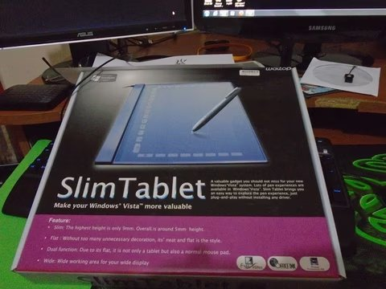
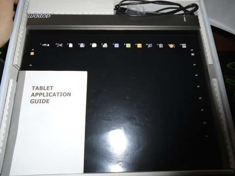
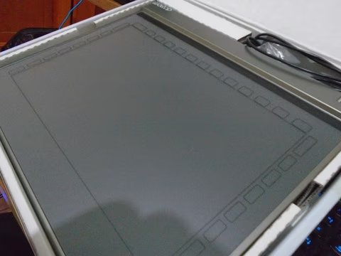

# waltop-intel-osx

**Pen pressure for the WALTOP Slim Tablet 12.1" (`172f:0031`) on macOS — in userspace, no kext, no SIP changes.**

The tablet is mislabelled by its own firmware. macOS therefore delivers position and
buttons but reports pressure as flat `0.0`, so every stroke is uniform and pressure
controls do nothing. `waltopd` reads the raw pressure the firmware *does* send and
republishes it as proper CoreGraphics tablet events.

**Status: working.** Verified drawing with pressure in Krita on one machine — see
[Testing scope](#testing-scope). No kernel extension involved.

---

## The device

| | |
|---|---|
| USB ID | `172f:0031` (vendor `0x172F`, product `0x0031`) |
| Marketing name | WALTOP Slim Tablet 12.1" |
| Reported by | `Slim Tablet` / `WALTOP International Corp.` |
| Interface | 1x USB 1.10 HID, 1 interrupt endpoint, 12 Mb/s |
| Coordinate range | `0..10000` × `0..6250` (as reported by the author's unit) |
| Pressure range | `0..1023` (as reported by the author's unit) |

These values come from the one unit this project was developed on. Other units,
rebadged variants, or firmware revisions have not been examined.

Not supported: **tilt** and **multi-touch**. The shim only handles X, Y, pressure,
tip, barrel and in-range; no tilt or touch data was seen from the author's unit.

---



<sub>*WALTOP SlimTablet retail box (photo found online; source not yet identified).*</sub>



<sub>*The tablet from above, with its printed shortcut overlay and the "Tablet Application
Guide" booklet (photo found online; source not yet identified).*</sub>



<sub>*All three photos were found online; their source and licence have not yet been
identified (see [ATTRIBUTIONS.md](ATTRIBUTIONS.md)).*</sub>

---

## The problem, in two parts

### 1. The firmware mislabels pressure

The HID report descriptor declares the tip-pressure field with the **wrong usage ID**:

```
cookie=34   page=0x0D   usage=0x30   range=0..1023
                ^^^^^^^^^^^   ^^^^^
                Digitizer     0x30 = "X",  NOT 0x33 = "Pressure"
```

The value is genuinely 0–1023 pressure, but it is labelled as a second X coordinate.
macOS honours the declared usage, so it never populates the pressure field. The data
is in every USB report and is simply discarded on the way up the stack.

The hardware is fine. Captured straight from the USB endpoint during a real stroke:

```
635 → 651 → 664 → 675 → 683 → 690 → 697 → 701 → 704 → 707 → 710 → 712 → 713 → 714
→ 710 → 704 → 695 → 683 → 668 → 649 → 629 → 604 → 576 → 544 → 502 → 460 → 418 → 373 → 324 → 269 → 0
```

A clean analog ramp, peak, and decay.

### 2. Malformed proximity events made Krita dead

Even with pressure available, a Qt application (Krita) registered **no tablet at all** —
no pressure, no click, nothing. Qt registers a tablet device only when a proximity
event carries the **same device id** as the point events and has the **"enter" flag
set** (`qnsview_tablet.mm:76-82`). The first shim got both wrong, so Qt read every
proximity event as *"device 0 has left"*, deregistered the pen, and silently discarded
all 1638 tablet point events it was sent.

Fixing `makeProximity()` (see the source) is what made drawing work at all.

---

## The fix: `waltopd`

A single-file Swift program that does, in userspace, what a kext would have to do in
the kernel:

1. **Seizes** the device (`kIOHIDOptionsTypeSeizeDevice`) so the OS stops mis-reporting it.
2. **Reads the raw HID elements** — X, Y, pressure, tip, barrel, in-range — itself.
3. **Republishes** them as correctly-formed CoreGraphics tablet events (a proximity
   *enter*, then a stream of `tabletPointer` events carrying real pressure and the tip
   button bit).

Applications using Qt additionally need to trust the tablet event's own button bits:

```
QT_MAC_TABLET_IGNORE_BUTTON_MAPPING=1
```

Without it Qt decides "pen down" from its internal mouse state, which a synthetic
tablet event never updates.

---

## Install

The repository contains **source only — no prebuilt binary in the tree**. Build it
once with the Xcode Command Line Tools (`xcode-select --install` if `swiftc` is
missing):

```sh
git clone https://github.com/matthewhand/waltop-intel-osx.git
cd waltop-intel-osx/tools
swiftc -O -o waltopd waltopd.swift
```

This produces `tools/waltopd`: a single self-contained executable with no runtime
dependencies, which you can copy anywhere.

*(No prebuilt binary is published at present. The repository itself never stores a
binary — see [.gitignore](.gitignore).)*

---

## Usage

Run:

```sh
./tools/waltopd                 # seizes the tablet, logs to ./waltopd.log
```

Launch Krita correctly, in one command (this is what `kritadraw.sh` does):

```sh
pkill -x krita
./tools/waltopd &
launchctl setenv QT_MAC_TABLET_IGNORE_BUTTON_MAPPING 1
open -a Krita
```

Undo the environment variable when you are finished:

```sh
launchctl unsetenv QT_MAC_TABLET_IGNORE_BUTTON_MAPPING
```

Order matters: start `waltopd` **before** Krita, and set the env var **before**
`open -a Krita`. If you miss either, it silently falls back to no pressure.

Stop the shim with `Ctrl-C` or `pkill -x waltopd`.

### Options

| Flag | Effect |
|---|---|
| `--list` | List attached HID devices with vendor/product IDs, then exit |
| `--selftest` | Run the built-in event-encoding regression tests, then exit |
| `--no-seize` | Do not seize the device (debug; broken events interleave) |
| `--no-csv` | Skip `waltopd-samples.csv` |
| `--log-file PATH` | Write the log to `PATH` (default `./waltopd.log`) |
| `--debug` | Log every raw HID event |
| `--help` | Show usage |

### Output

| File | Contents |
|---|---|
| `waltopd.log` | Per-stroke summaries, 5-second stats, readiness checks |
| `waltopd-samples.csv` | `timestamp,x,y,pressure_raw,pressure_norm,tip` at 60 Hz |

---

## Troubleshooting

**Nothing draws at all.** Check `waltopd.log` for `[ready] SEIZED the tablet`. If it says
`NOT seized`, another process already holds the device. If you started Krita before the
shim, or forgot the env var, quit Krita (`pkill -x krita`) and use `kritadraw.sh`.

**"tablet not found".** The shim matches `172f:0031` exactly. Run:

```sh
./tools/waltopd --list
```

and look for vendor `0x172f`. Confirm your device is attached and, if it is a different
WALTOP model, change `VENDOR`/`PRODUCT` at the top of `waltopd.swift`.

**Pressure is erratic or double.** You are running with `--no-seize`, so the OS's broken
events are interleaving with the shim's. Drop the flag.

**"another waltopd is already running".** `pkill -x waltopd` first.

**Pressure still 0 in the log.** Look for `[warn] no pressure element bound`. Your unit
may declare pressure differently; the element cookies are logged at startup as
`[hid] bound x=… pressure=…`.

**Coordinates land on the wrong display.** The shim currently maps the tablet across the
main display only (`CGMainDisplayID()`). Multi-monitor mapping is not implemented.

---

## Testing scope

**Everything here was tested on exactly one machine and one tablet. It has not been
validated on any other configuration.**

| | |
|---|---|
| OS | macOS 14.8.7 (Sonoma) |
| Architecture | Intel (`x86_64`) |
| Application | Krita 5.3.4.1 (Qt 5) |

### Explicit non-claims

- Not tested on any other `172f:*` product, or on any rebadged or similar-looking
  tablet. Other models may have different descriptors.
- Not tested on Apple Silicon. Nothing in the code is known to be Intel-specific, but
  this is unverified.
- Not tested on macOS versions other than 14.8.7.
- Not tested with any application other than Krita.
- Assumes the tablet reports X/Y/pressure at the standard element locations and a
  `0..10000 × 0..6250` area. Other firmware revisions may differ — `--list` and the
  `[hid] bound` log line are your first stop if so.

---

## Why not a kext?

A kernel extension could rewrite the descriptor (`0x30` → `0x33`) before `IOHIDFamily`
parses it — the approach Linux's `drivers/hid/hid-waltop.c` takes for several WALTOP
tablets (that driver does not list `172f:0031`). On macOS that path
requires SIP disabled and reduced security, and loading any kext can wake dormant
third-party kexts (this machine has disk-array and boot-geometry kexts present on disk
but not loaded), risking an unbootable system.

Userspace virtual HID (`IOHIDUserDevice` / CoreHID) would be cleaner still, but requires
the Apple-granted entitlement `com.apple.developer.hid.virtual.device`, which this
project does not have.

The userspace shim avoids both problems entirely.

---

## Layout

```
waltop-intel-osx/
├── README.md              this file
├── ATTRIBUTIONS.md        third-party material (photo provenance)
├── kritadraw.sh           one-command launch for Krita
├── LICENSE                MIT
├── docs/
│   ├── tablet-reference.jpg   retail box (third-party photo)
│   ├── tablet-top-down.jpg    tablet from above (third-party photo)
│   └── tablet-surface.jpg     drawing surface (third-party photo)
└── tools/
    ├── waltopd.swift      the shim (single file; build to `waltopd`)
    ├── selftest.swift     standalone CGEvent delivery probe
    ├── PressureTap.swift  raw pressure capture from the USB endpoint
    ├── ModeSwitch.swift   feature-report mode switch probe
    └── ModeSweep.swift    descriptor-capture across modes
```

Compiled binaries and runtime output (`*.log`, `*.csv`, `*.lock`) are git-ignored;
only source is committed. Build the shim with the command in [Install](#install).

---

## License

MIT — see [LICENSE](LICENSE). The photos in `docs/` are third-party images whose
source and licence are unknown; they are not covered by the MIT licence. See
[ATTRIBUTIONS.md](ATTRIBUTIONS.md).
